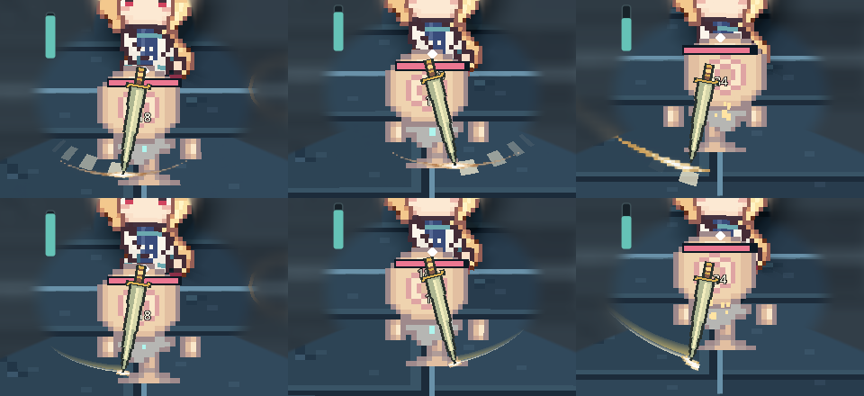

# การออกแบบเอฟเฟกต์ฟันอาวุธ

## แบบที่ใช้กับดาบปกติ

ฟันปกติมีสามที สองทีแรกกวาดสลับทิศและมีรอยแสงสั้น ทีที่สามฟันเฉียงลงและให้ความรู้สึกหนักขึ้นด้วยรอยที่กว้างกว่าและจางช้ากว่า รอยแสงใช้ขอบขาวไล่เข้าหาสีเงินโปร่ง หัวแสงใช้ภาพ 2D ขนาดเล็กยึดกับปลายดาบที่ผู้เล่นเห็น ส่วนหางแสงไล่ตามตำแหน่งปลายดาบที่เพิ่งผ่านในท่าฟันนั้น

ตำแหน่งของรอยแสงอ้างจากดาบหลังจัดท่าตัวละครแล้ว เอฟเฟกต์ใช้กติกาการโจมตีเดิมในการกำหนดช่วงฟัน ส่วนคลื่นดาบที่เดินทางออกจากตัวและประกายตอนโดนเป้าให้เริ่มตามจังหวะปล่อยคลื่นหรือจังหวะโดนเป้าของท่านั้น

## ปัญหาที่พบและวิธีแก้

- **อาการ** — ในเกมบางมุม หัวแสงอยู่ใกล้ปลายดาบแต่หางแสงยื่นไปข้างหน้าแนวฟัน เห็นชัดในฟันทีที่สาม
- **สาเหตุ** — ภาพรอยฟันมีเส้นโค้งวาดไว้ล่วงหน้าทั้งเส้น การย้ายหัวภาพให้ตรงปลายดาบแก้ตำแหน่งเพียงจุดเดียว ส่วนโค้งที่เหลือยังเป็นเส้นเดิมแม้ทิศและความเอียงของดาบเปลี่ยนไป
- **วิธีแก้** — เก็บตำแหน่งปลายดาบและด้ามจากดาบที่แสดงในเกม แล้ววาดหางแสงผ่านตำแหน่งที่ผ่านมา เก็บภาพ 2D ไว้สำหรับหัวแสง และเริ่มเก็บเส้นใหม่ทุกคม รอยเก่าจางจากตำแหน่งสุดท้ายหลังพ้นช่วงฟัน [จุดสร้างรอยแสง](../scripts/basic_sword_slash.gd) · [จุดอ่านท่าดาบในเกม](../scripts/game.gd#L1695)
- **หลักฐาน** — สนามฝึกกับหุ่นหนึ่งตัว ตรวจจังหวะฟันทั้งสามทีจากการเล็ง 4 ทิศ รวม 240 เฟรมช่วงฟัน ตรวจตำแหน่งหัวแสง จุดปลายรอย และการเริ่มเส้นใหม่ทุกคม ภาพเทียบแสดงตัวอย่างจากหนึ่งในทิศที่ตรวจ ผลครอบคลุมฟันปกติด้วยดาบที่ใช้ทดสอบ ส่วนการถืออาวุธสองข้างและเอฟเฟกต์ของสกิลอยู่นอกขอบเขตของการตรวจรอบนี้

## ข้อที่ต้องตรวจรอบต่อไป

1. **กำหนดจังหวะของภาพแต่ละส่วน** — ระบุช่วงออกคม ช่วงรอยจาง และคมปิดคอมโบ แยกจังหวะเกิดรอยฟัน คลื่นที่ปล่อยออกไป และประกายเมื่อโดนเป้า
2. **ยึดภาพกับอาวุธที่เห็นในเกม** — อ่านตำแหน่งคมหรือปลายดาบหลังจัดท่าตัวละคร แล้วสร้างหางจากจุดที่คมเพิ่งผ่าน ภาพสำเร็จรูปใช้เสริมแสงที่จุดยึด
3. **เริ่มรอยใหม่ทุกครั้งที่เปลี่ยนคมหรือมือ** — ตรวจช่วงต่อคอมโบและช่วงจางว่ารอยเดิมจบในจุดของตัวเองและไม่มีเส้นลากข้ามไปยังคมถัดไป
4. **ดูคอมโบจริงหลายทิศ** — เล็งซ้าย ขวา เข้าหากล้อง และออกจากกล้อง ดูความเร็วเล่นจริงก่อน แล้วหยุดดูช่วงเริ่ม กลาง ปลาย และรอยจางของแต่ละคม ให้หัวแสงอยู่ที่คมและหางอยู่บนแนวที่ดาบผ่านไปแล้ว
5. **ตรวจแรงส่งของคมปิดพร้อมผลการโจมตี** — ดูว่าความกว้าง ความสว่าง หรือระยะจางทำให้คมปิดอ่านง่ายขึ้น แล้วลองทั้งฟันโดนและฟันวืดเพื่อเช็กว่าภาพสื่อผลถูกจังหวะ เก็บภาพก่อน–หลังกับทิศที่ตรวจไว้สำหรับรีวิว

กติกาที่ใช้ซ้ำอยู่ใน [ABIL-004](../.agents/skills/emberwake-design/references/abilities.md#abil-004--build-weapon-trails-from-the-visible-swing)
